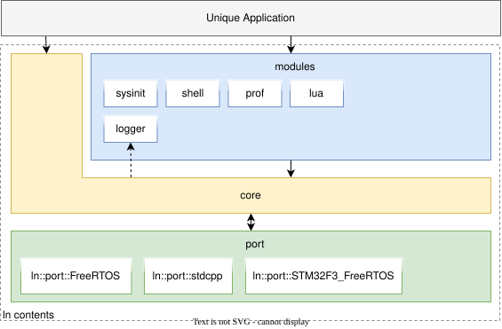

# Architecture

## Principles

- `ln` follows the principles of [SOLID](https://en.wikipedia.org/wiki/SOLID)
  with a touch of pragmatic common sense. It values great architecture,
  simplicity, performance, maintainability, modularity and reusability.
- `ln` requires C++23, and C23 for any C code. Their features can be used
  anywhere in the codebase and do not count as dependencies.
- Feature dependence is a spectrum: from none, to dependence on `core`, multiple
  other `ln/` modules, third-party libraries, etc. However, sustaining minimal
  dependency often comes at the cost of bloat and increased code complexity,
  which leads to poor architecture. This is a trade-off the developer must
  carefully consider - there is no silver bullet and every feature is unique.
  The developer may look for examples in `ln` to get a sense of where the sweet
  spot is, but must stay skeptical, think critically and never take the present
  `ln` architecture for granted.

## Modules

- Features are organized into modules - folders under the `ln/` directory. A
  module folder and its C++ namespace share the same name, see
  [Casing](CODING_STYLE.md#casing).
- [`core`](../ln/core/) is a special module - the only foundation shared by all
  other modules. It contains fundamental generic features tailored for embedded
  systems.
- Modules depend directly on [`core`](../ln/core/). Direct dependencies between
  modules (e.g. `sysinit` on `algo`) are kept to a minimum. Otherwise modules
  relate to each other through well-defined interfaces in `core`, see
  [Interfaces](#interfaces).
- [`logger`](../ln/logger/) is a special module close to [`core`](../ln/core/):
  its macro API lives in [`ln/log.h`](../ln/core/include/ln/log.h), so when
  `LN_LOGGER` is enabled `core` itself depends on it. When it is disabled the
  macros expand to nothing and `logger` can be omitted from the build.

## Platform Independence and Ports

- Everything under [`ln/`](../ln/) must be platform-independent wherever
  possible, unless the feature is inherently platform-specific.
  [`core`](../ln/core/) is entirely platform-independent - platform-specific
  code is decoupled through the [`port/`](../port/) system.
- Ports are managed in CMake. Each port carries different platform-specific
  dependencies and covers some part of the `core` implementation. A project that
  uses `ln` can select and use only one port in a build at a time. Some ports
  only partially cover the `core` feature-set and cannot be used directly (e.g.
  [`port/FreeRTOS`](../port/FreeRTOS)). These are combined and/or derived to
  form a complete port (e.g.
  [`port/STM32F3_FreeRTOS`](../port/STM32F3_FreeRTOS)) which can then be
  selected in a project build.

## Interfaces

[`core`](../ln/core/) provides two kinds of interfaces:

- OS abstraction layer (OSAL) interfaces. `ln` is designed with RTOS support in
  mind: these are platform-independent abstractions for common RTOS features
  (mutex, semaphore, queue, thread), located in
  [`ln/core/include/ln/osal/`](../ln/core/include/ln/osal/) under the
  `ln::osal` namespace. Each port implements them to provide the final types,
  e.g. `osal::Mutex` becomes `ln::Mutex`. `ln::osal` is the contract between
  `core` and the ports and is not meant to be used directly - use the final
  types.
- Module interfaces, e.g. `ln::File`, `ln::ReadStream` and `ln::WriteStream`,
  through which modules relate to each other. Unlike OSAL interfaces, these are
  implemented by `core` or other modules rather than ports.

By following these rules, it should be possible to cherry-pick any meaningful
feature from `ln/` together with [`core`](../ln/core/) and one of the `port/`
implementations to use it in a project.
